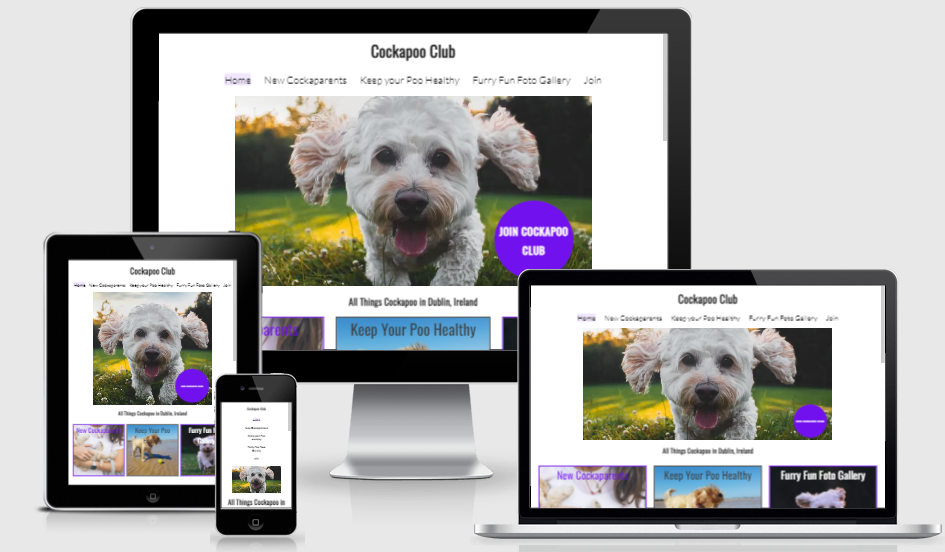

# Cockapoo Club

A fictional Dublin dog-club website created as a frontend portfolio project. It brings practical dog-care information, a photo gallery and club information into one place.

**HTML · CSS · JavaScript**

[Visit the website](https://samobrienolinger.github.io/Cockapoo-Club/) · [Getting started](#getting-started) · [Repository guide](#repository-guide) · [Checks](#checks-and-review) · [Credits](#credits-and-reuse)



## What you can explore

- Browse guidance for new Cockapoo owners and dog-care articles.
- Explore the Furry Fun Foto Gallery.
- View club information and join-form layouts.

> **Project notes:** This is a portfolio demonstration. The static forms and member pages do not by themselves provide a server-side membership service.

## Getting started

Requires a browser and a local HTTP server. Python 3 provides one without installing application packages.

```bash
git clone https://github.com/SamOBrienOlinger/Cockapoo-Club.git
cd Cockapoo-Club
python3 -m http.server 8000 --bind 127.0.0.1
```

Open [localhost:8000](http://localhost:8000). Serve the repository over HTTP so module imports, relative assets and page links resolve correctly.

## Repository guide

| Path | Purpose |
| --- | --- |
| [index.html](index.html) | Primary browser entry point |
| [assets/](assets/) | Project styles, scripts, data and imagery |

## Checks and review

No automated application test command is configured in this snapshot.

For a manual review, follow the main user journey, check keyboard navigation and narrow-screen layouts, and inspect the browser console for missing assets or failed requests.

## Deployment

A GitHub Pages site is configured for this repository. Its published URL is linked at the top of this README.

## Credits and reuse

Design decisions, original feature notes, historical testing evidence and detailed acknowledgements remain available in the preserved project record:

- [README.md · original project record](https://github.com/SamOBrienOlinger/Cockapoo-Club/blob/784b7fc061d57110c39f02e6336c594c391c71d5/README.md)

Learning resources and starter material: [Code Institute](https://codeinstitute.net/).

No repository-level licence file is present in this snapshot. This README does not grant additional reuse permissions. Check with the relevant rights holders before reusing code, written content or assets.

## Support

Repository maintained in [Sam O’Brien-Olinger’s GitHub account](https://github.com/SamOBrienOlinger). For a problem or suggested improvement, [open an issue](https://github.com/SamOBrienOlinger/Cockapoo-Club/issues) with the affected page or command, steps to reproduce, and expected behaviour.

[Back to top](#cockapoo-club)
